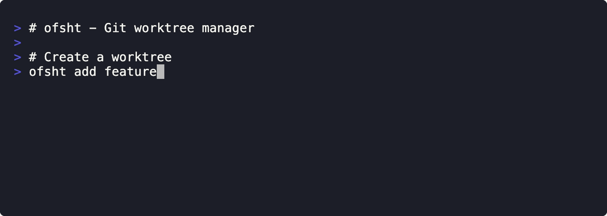

# ofsht

[](https://github.com/wadackel/ofsht/actions/workflows/ci.yaml?query=branch%3Amain)
[](https://crates.io/crates/ofsht)
[](https://github.com/wadackel/ofsht/blob/main/LICENSE)

A command-line tool for managing Git worktrees with automation features.

## Demo



**Demonstrated features:**
- Creating worktrees with the `add` command
- Listing all worktrees with `ls`
- Configuring and executing hooks for automation
- Removing multiple worktrees with `rm`

## Table of Contents

- [Features](#features)
- [Installation](#installation)
- [AgentSkill for AI Agents](#agentskill-for-ai-agents)
- [Quick Start](#quick-start)
- [Usage](#usage)
  - [Basic Operations](#basic-operations)
  - [Stdin Input](#stdin-input)
  - [Sync Hook Operations](#sync-hook-operations)
  - [GitHub Integration](#github-integration)
  - [Shell Integration](#shell-integration)
  - [Repository Layouts](#repository-layouts)
  - [Configuration](#configuration)
  - [zoxide Integration](#zoxide-integration)
  - [tmux Integration](#tmux-integration)
  - [Open All Worktrees in tmux](#open-all-worktrees-in-tmux)
  - [Shell Completion](#shell-completion)
- [Common Workflows](#common-workflows)
- [FAQ](#faq)
- [Documentation](#documentation)
- [License](#license)

## Features

🌳 **Worktree Management**
- Create worktrees from branches, tags, or commits
- List all worktrees with status information
- Navigate to worktrees by branch name
- Remove worktrees with automatic cleanup of merged branches (unmerged branches are kept)
- Interactive worktree selection with fzf integration
- Read branch / target names from stdin when piped (auto-detected for `add`, `create`, `cd`, `rm`)

⚙️ **Automation & Hooks**
- Run commands after worktree creation (e.g., `npm install`)
- Copy files from main repository (e.g., `.env`, `.nvmrc`)
- Create symlinks for shared directories (e.g., `.vscode`)
- Execute cleanup commands before worktree deletion
- Sync hook operations to all existing worktrees with `ofsht sync`
- Customize worktree paths with `{repo}` and `{branch}` variables

💻 **Shell Integration**
- Automatic directory changing for `add` and `cd` commands
- Shell completion for Bash, Zsh, and Fish
- Automatic zoxide integration for quick navigation

📝 **Configuration**
- Local configuration (`.ofsht.toml` in project root)
- Global configuration (`~/.config/ofsht/config.toml`)
- XDG Base Directory specification support

## Installation

### From crates.io

```bash
cargo install ofsht
```

### From Homebrew

```bash
brew install wadackel/tap/ofsht
```

### From Binary Releases

Download pre-built binaries from the [releases page](https://github.com/wadackel/ofsht/releases).

```bash
# macOS (Apple Silicon)
curl -L https://github.com/wadackel/ofsht/releases/latest/download/ofsht-aarch64-apple-darwin.tar.gz | tar xz
sudo mv ofsht /usr/local/bin/

# macOS (Intel)
curl -L https://github.com/wadackel/ofsht/releases/latest/download/ofsht-x86_64-apple-darwin.tar.gz | tar xz
sudo mv ofsht /usr/local/bin/

# Linux (x86_64)
curl -L https://github.com/wadackel/ofsht/releases/latest/download/ofsht-x86_64-unknown-linux-gnu.tar.gz | tar xz
sudo mv ofsht /usr/local/bin/
```

### From Source

For a reproducible development environment, use the repository's [Nix](https://nixos.org/) flake:

```bash
git clone https://github.com/wadackel/ofsht.git
cd ofsht
nix develop
cargo build --release
sudo mv target/release/ofsht /usr/local/bin/
```

If you manage the toolchain yourself, install [Rust](https://www.rust-lang.org/tools/install) and run the same `cargo build --release` command from the checkout.

## AgentSkill for AI Agents

`ofsht` provides an AgentSkill for AI coding agents that need to manage worktrees through this CLI. Install it with the GitHub CLI `gh skill` preview command:

```bash
gh skill install wadackel/ofsht ofsht --agent codex --scope project
```

Preview the skill before installing:

```bash
gh skill preview wadackel/ofsht ofsht
```

Update an installed skill:

```bash
gh skill update ofsht
```

> [!NOTE]
> `gh skill` is a preview GitHub CLI feature and may change. The AgentSkill teaches agents how to use the existing `ofsht` CLI safely; it does not install the `ofsht` binary itself.

## Quick Start

```bash
# Create a new worktree and navigate to it (with shell integration)
ofsht add feature-awesome

# Create a worktree based on a specific branch
ofsht add feature-awesome develop

# Create from a remote branch
ofsht add hotfix-123 origin/main

# Create from a tag
ofsht add release-prep v1.2.0

# List all worktrees
ofsht ls

# Navigate to a worktree (with shell integration)
ofsht cd feature-awesome

# Remove a worktree
ofsht rm feature-awesome
```

> [!TIP]
> The `add` command automatically navigates to the new worktree when shell integration is enabled. Use `create` instead if you want to stay in the current directory. See [Shell Integration](#shell-integration) for setup.

## Usage

### Basic Operations

#### Create a Worktree

`ofsht` provides two commands for creating worktrees:

- **`add`**: Creates a worktree and prints its path to stdout (for shell integration to navigate automatically)
- **`create`**: Creates a worktree but stays in the current directory (no path output)

```bash
# Create and navigate to worktree (with shell integration)
ofsht add feature-awesome
# /absolute/path/to/worktrees/my-project/feature-awesome

# Create a new worktree (stays in current directory)
ofsht create feature-awesome
# Created worktree at: ../worktrees/my-project/feature-awesome

# Create from a specific start point
ofsht add feature-awesome develop     # From branch
ofsht add hotfix-123 origin/main      # From remote branch
ofsht add release-prep v1.2.0         # From tag

# Work on a remote branch locally: a local branch tracking it
ofsht add feature-x origin/feature-x

# A pool member on a detached HEAD, without a branch named after it
ofsht add --detach slot-1 origin/main

# Create with tmux integration (requires running inside tmux)
ofsht add feature-awesome --tmux      # Creates worktree and opens new tmux window
```

> [!NOTE]
> The first argument is always a local branch name: an existing local branch is checked out, and any other name, including one that matches a tag or a commit, becomes a new branch. A remote-tracking name such as `origin/feature-x` is refused with the command to use instead, `ofsht add feature-x origin/feature-x`. A branch that another worktree already has checked out is refused too, naming that worktree and the `ofsht cd` command that reaches it; when that worktree's directory is gone, the message gives the commands to run first: `git worktree prune`, preceded by `git worktree unlock` for a locked worktree.

> [!NOTE]
> Without a start point, the new branch starts from the HEAD of the worktree you run the command in, as with plain `git worktree add`, so running it inside a pooled worktree branches off that worktree's current commit. Relative start points such as `HEAD~1` are read in that worktree too.

> [!NOTE]
> A branch started from a remote branch with another name, such as `ofsht add hotfix-123 origin/main`, gets no upstream, so `git push` does not try to push to `main`; publish it with `git push -u origin hotfix-123`. A branch with the same name as its remote branch, such as `ofsht add feature-x origin/feature-x`, tracks it. If you set `branch.autoSetupMerge` yourself, ofsht leaves tracking to that setting.

#### List Worktrees

```bash
# List all worktrees
ofsht ls
# /path/to/my-project                                d070cdf [main]
# /path/to/worktrees/my-project/feature-awesome      d070cdf [feature-awesome]

# Show only paths (useful for scripting)
ofsht ls --show-path
# /path/to/my-project
# /path/to/worktrees/my-project/feature-awesome
```

#### Navigate to a Worktree

```bash
# With shell integration (automatic cd)
ofsht cd feature-awesome

# Without shell integration
cd $(ofsht cd feature-awesome)

# Interactive selection with fzf (when no branch name provided)
ofsht cd

# Back to the main worktree
ofsht cd main
ofsht cd @
```

#### Remove a Worktree

```bash
# Remove by path
ofsht rm /path/to/worktrees/my-project/feature-awesome

# Remove by branch name
ofsht rm feature-awesome

# Remove current worktree
ofsht rm .

# Remove multiple worktrees
ofsht rm feature-a feature-b feature-c

# Interactive selection with fzf (when no target provided)
ofsht rm

# Remove prunable worktrees (those whose directories have been manually deleted)
# Works with branch names, absolute paths, or relative paths
ofsht rm feature-deleted

# Keep the branch and remove only the worktree
ofsht rm --keep-branch feature-awesome

# Delete the branch even if it has unmerged commits
ofsht rm --force-branch feature-awesome

# Remove a worktree with modified or untracked files or initialized submodules
ofsht rm --force feature-awesome

# Show what would be removed, which hooks would run, and what would happen to each branch
ofsht rm --dry-run feature-awesome
```

`--dry-run` changes nothing and prints its plan to stderr, so the shell integration does not change directory. It runs the same checks as a real removal: when any target would be refused, it lists only the refusals, ends with `Nothing would be removed: N worktree(s) refused`, and exits with 1; otherwise it exits with 0. Whether `git branch -d` succeeds is decided by Git at removal time, so the plan says `would try git branch -d <branch>` rather than predicting it.

> [!NOTE]
> Before running any delete hook, `ofsht rm` checks every target for what `git worktree remove` would refuse (a locked worktree, modified or untracked files, initialized submodules) and for work the removal would lose for good: commits that only a detached HEAD reaches, and a rebase, merge, cherry-pick, revert, or bisect in progress. If any target would be refused, nothing is removed and every refused target is listed. `--force` lets all of these go except a lock, as `git worktree remove --force` does for files and submodules; it does not imply `--force-branch`. A locked worktree is refused even with `--force`; run `git worktree unlock` first. Because the check runs before the delete hooks, a worktree that a hook would have cleaned up needs `--force`.

> [!NOTE]
> By default, `ofsht rm` deletes the worktree's branch with `git branch -d`, so a branch with unmerged commits is kept and a warning is printed. Git checks whether the branch is merged into its upstream when one is set, and into the HEAD of the main worktree otherwise; a branch started from a remote branch with another name has no upstream until you push it, so it is compared with the main worktree's HEAD. Branches merged through a GitHub squash or rebase merge look unmerged to Git; delete them with `--force-branch`.
>
> The default branch is never deleted, even with `--force-branch`: the branch `origin/HEAD` points to, `init.defaultBranch`, `main`, and `master`. Delete it with `git branch -D` if you mean to.
>
> When a long-lived worktree has moved to another branch, the branch it was created with (the one `worktree.dir` gives its path, such as `slot-1`) is also deleted with `git branch -d` unless you pass `--keep-branch`. It stays when it is unmerged or checked out in another worktree.

> [!NOTE]
> `ofsht rm` can remove worktrees even if their directories have been manually deleted. Git marks such worktrees as "prunable" (still registered in Git but directory missing), and `ofsht` handles them gracefully by cleaning up the Git registration.

#### Worktree Names

`ofsht cd` and `ofsht rm` accept these forms:

| Form | Example |
|---|---|
| Branch name | `feature/login` |
| Path below the directory set by `worktree.dir` | `wt1`, `feature/a` |
| Directory name of a worktree outside that directory | `review` |
| Absolute path, or a path relative to the current directory | `~/tmp/review`, `../myapp-worktrees/wt1` |

A name may match a worktree by its branch and another by its directory, for example after `git switch` in a long-lived worktree. A worktree inside the `worktree.dir` directory wins over a worktree outside it with the same directory name. When the name still matches more than one worktree, it is rejected instead of picking one:

```text
Error: Ambiguous worktree name: slot-2
  ~/dev/myapp-worktrees/slot-1 [slot-2]
  ~/dev/myapp-worktrees/slot-2 [other]
Specify a path
```

`ofsht ls`, fzf, and shell completion show a name you can type for each worktree. When a worktree's short name would reach something else, `ofsht ls` and fzf show its path instead, and shell completion offers only a branch name that reaches it. When neither name reaches it, use its path.

`ofsht cd` goes to the main worktree for `@`, for the main worktree's branch name, and for its path. `ofsht rm` refuses all three.

### Stdin Input

When stdin is piped or redirected, `ofsht` automatically reads positional arguments from it. CLI arguments always take priority; stdin is used only when the corresponding argument is omitted.

```bash
# add / create read the first non-empty line as the branch name
echo my-feature | ofsht add
echo bugfix-1 | ofsht create

# cd reads the first non-empty line as the worktree name
echo feature-awesome | ofsht cd

# rm reads each non-empty line as a target (xargs-style)
printf 'feature-a\nfeature-b\n' | ofsht rm

# CLI arguments always win — stdin is ignored when an argument is present
echo ignored-name | ofsht add explicit-name   # creates "explicit-name"
```

> [!NOTE]
> Stdin is read only when the input is **not a TTY** (i.e. piped or redirected). On an interactive terminal with no arguments, `cd` / `rm` continue to launch fzf as before, and `add` / `create` exit with `branch name required`.

> [!NOTE]
> For `add` / `create` (single-argument), only the first non-empty line is used. For `rm` (multi-argument), every non-empty line becomes a target.

### Shell Integration

`ofsht` provides shell integration for automatic directory changing with `cd` and `add` commands.

**Setup** (one-time):

```bash
# Bash - Add to ~/.bashrc
eval "$(ofsht shell-init bash)"

# Zsh - Add to ~/.zshrc
eval "$(ofsht shell-init zsh)"

# Fish - Add to ~/.config/fish/config.fish
ofsht shell-init fish | source
```

After setup, reload your shell configuration:
```bash
source ~/.bashrc  # or ~/.zshrc for Zsh
```

**Usage** (after shell integration):

```bash
# Create and automatically navigate to the new worktree
ofsht add feature-awesome
# You're now in the new worktree directory!

# Navigate to an existing worktree
ofsht cd another-feature
# You're now in the another-feature worktree!

# Remove current worktree and return to main repository
ofsht rm .
# You're now back in the main repository!

# If you want to create without navigation, use:
ofsht create feature-awesome
```

**How it works**: The `shell-init` command generates a wrapper function that intercepts `cd`, `add`, and `rm` subcommands, automatically executing `cd` after the operation completes.

> [!CAUTION]
> The shell wrapper only works in interactive shells. You must add the `eval "$(ofsht shell-init <shell>)"` line to your shell's rc file (`~/.bashrc`, `~/.zshrc`, or `~/.config/fish/config.fish`) and reload it. The wrapper will not work in non-interactive scripts.

### Repository Layouts

`ofsht` treats the main worktree's directory as the repository root: it reads `.ofsht.toml` there and resolves `worktree.dir` from it.

| Layout | Root |
|---|---|
| Standard (`<root>/.git`) | `<root>`, from the main worktree or any linked worktree |
| Bare repository kept as `<root>/.git`, or behind a `<root>/.git` file such as `gitdir: ./.bare` | `<root>` |
| `git init --separate-git-dir` | The work tree, when run from it |
| Other bare repositories | Not supported: `Bare repositories are not supported` |

From a linked worktree of a `--separate-git-dir` repository, git has no record of the main worktree, so `ofsht` stops with `Cannot locate the main worktree`; run it from the main worktree. If that separate git directory is itself named `.git`, a linked worktree cannot tell it apart from the standard layout, and `ofsht` treats the directory containing it as the root.

### Configuration

`ofsht` uses a two-tier configuration system with clear inheritance rules:

**Configuration Priority:**
1. **Local config** (`.ofsht.toml` in project root): Only `[worktree]` and `[hooks.*]` settings
2. **Global config** (`~/.config/ofsht/config.toml`): All settings, including integrations
3. **Built-in defaults**: Fallback values if no config files exist

> [!IMPORTANT]
> Integration settings (`[integration.zoxide]`, `[integration.fzf]`, `[integration.tmux]`, `[integration.gh]`) are ONLY read from global config, never from local config. Placing them in `.ofsht.toml` will silently have no effect.

#### Local Configuration

Create `.ofsht.toml` in your project root:

```toml
[worktree]
# Customize worktree directory template
dir = "../worktrees/{repo}/{branch}"

[hooks.create]
# Run commands after worktree creation
run = ["pnpm install", "echo Setup complete!"]

# Copy files from main repository
copy = [".env", ".nvmrc"]

# Create symlinks (source in repo -> destination in worktree)
link = { ".vscode" = ".vscode" }

[hooks.delete]
# Run commands before worktree deletion
run = ["echo Cleaning up..."]
```

#### Generating Configuration Files

Use `ofsht init` to generate configuration files with default settings:

```bash
# Generate both global and local config files
ofsht init

# Generate only global config
ofsht init --global

# Generate only local config (in current project)
ofsht init --local

# Overwrite existing config files
ofsht init --force
```

> [!WARNING]
> `ofsht init --force` will overwrite both global and local config files if they exist. This will destroy any existing hook configurations or custom settings. Use with caution.

#### Global Configuration

Create `~/.config/ofsht/config.toml` for global settings (or use `ofsht init --global`):

```toml
[worktree]
# Default directory template for all projects
dir = "../{repo}-worktrees/{branch}"

[integration.zoxide]
# Enable/disable zoxide integration
enabled = true  # Default: true

[integration.fzf]
# Enable/disable fzf integration
enabled = true  # Default: true

# Additional fzf command-line options
options = ["--height=50%", "--border"]

[integration.tmux]
# Configure tmux integration behavior
behavior = "auto"   # "auto" (default, flag-based), "always", "never"
create = "window"   # "window" (default) or "pane"
open = "window"     # Default mode for `ofsht open`: "window" or "pane"

[integration.gh]
# Enable/disable GitHub integration
enabled = true  # Default: true
```

### Sync Hook Operations

After adding new shared files to your hook configuration, use `sync` to apply them to all existing worktrees:

```bash
# Sync all hook actions (run + copy + link) to all existing worktrees
ofsht sync

# Only sync symlinks
ofsht sync --link

# Only sync file copies
ofsht sync --copy

# Combine flags
ofsht sync --run --copy
```

> [!TIP]
> `ofsht sync` is idempotent. Existing symlinks pointing to the correct target are left unchanged, and files are overwritten safely. You can run it repeatedly without side effects.

> [!NOTE]
> `ofsht sync` re-applies `hooks.create` actions only. It does not execute `hooks.delete` actions. If a worktree directory is missing, it is skipped with a warning.

### GitHub Integration

When the `gh` CLI is installed and authenticated, you can create worktrees directly from GitHub issues or pull requests:

```bash
# Create worktree from GitHub issue
ofsht add #123
# Creates a worktree with branch name from the issue

# Create worktree from GitHub pull request
ofsht add #456
# Creates a worktree from the PR's head branch
```

> [!IMPORTANT]
> **Requirements for GitHub Integration:**
> - `gh` CLI must be installed (https://cli.github.com/)
> - You must be authenticated with GitHub (run `gh auth login`)
> - Command must be run inside a repository connected to GitHub
>
> Without these requirements, `ofsht add #123` will fail with "gh: command not found" or authentication errors.

The GitHub integration automatically:
- Fetches issue/PR information using `gh` CLI
- Generates appropriate branch names
- Creates the worktree with the correct base branch

For a pull request, an existing local branch is fast-forwarded to the fetched head when
it is not checked out and has no local-only commits. Otherwise, ofsht preserves the
branch and warns when it differs. A checked-out branch is left untouched and the error
shows how to navigate to its worktree.

Fork PR branches use the PR's head name, or `pr-<number>-<head>` when that name belongs
to an unrelated local branch. ofsht records the PR association in local branch config,
so repeating `add` points to the existing worktree rather than creating a duplicate.
Branches created before this association was recorded are treated as unrelated.

To disable GitHub integration, set `enabled = false` in global config:

```toml
[integration.gh]
enabled = false
```

### zoxide Integration

When `zoxide` is installed and enabled (default), created worktrees are automatically registered with zoxide for quick navigation:

```bash
# After creating a worktree
ofsht add feature-awesome
# or
ofsht create feature-awesome

# You can now jump to it using zoxide
z feature-awesome

# Disable zoxide integration in global config (~/.config/ofsht/config.toml)
[integration.zoxide]
enabled = false
```

### tmux Integration

`ofsht` can automatically create tmux windows or panes when creating worktrees.

**Configuration Options:**

```toml
# In ~/.config/ofsht/config.toml
[integration.tmux]
behavior = "auto"   # or "always", "never"
create = "window"   # or "pane"
```

- **`behavior`**:
  - `"auto"` (default): Only use tmux when `--tmux` flag is specified
  - `"always"`: Automatically create tmux window/pane for every worktree
  - `"never"`: Disable tmux integration entirely

- **`create`**:
  - `"window"` (default): Create a new tmux window
  - `"pane"`: Split current window horizontally

**CLI Overrides:**

```bash
# Temporarily enable tmux (overrides config)
ofsht add feature-awesome --tmux

# Temporarily disable tmux (overrides config, even with behavior="always")
ofsht add feature-awesome --no-tmux

# With behavior="always" in config, tmux is used by default
ofsht add feature-awesome  # Creates tmux window/pane automatically
```

> [!CAUTION]
> tmux integration requires running `ofsht add` inside an active tmux session. Using `--tmux` flag or `behavior = "always"` outside of tmux will fail with an error. Remote sessions via SSH must preserve the `$TMUX` environment variable.

**Window/Pane Behavior:**
- New windows are automatically focused and set to the worktree directory
- Window names are sanitized from branch names (e.g., `"feature/login"` → `"feature·login"`)
- Panes are created with horizontal split in the current window

**Requirements:**
- Must be running inside a tmux session when tmux integration is active
- tmux binary must be available in PATH

### Open All Worktrees in tmux

Quickly restore your tmux workspace by opening all worktrees at once:

```bash
# Open all worktrees in separate tmux windows (default)
ofsht open

# Open all worktrees as panes in the current window
ofsht open --pane

# Explicitly request window mode
ofsht open --window
```

The current worktree is automatically skipped (you're already there). Each window is named after the worktree's name from `ofsht ls` (e.g., `feature-login`, `docs·update`).

**Configuration:**

```toml
# In ~/.config/ofsht/config.toml
[integration.tmux]
open = "window"   # Default mode for `ofsht open`: "window" or "pane"
```

CLI flags (`--pane`, `--window`) override the config value.

> [!CAUTION]
> `ofsht open` requires running inside a tmux session. Running outside tmux will fail with an error.

### Shell Completion

`ofsht` provides dynamic shell completion with smart branch and worktree name suggestions.

To see setup instructions for your shell:

```bash
# Display setup instructions
ofsht completion bash    # For Bash
ofsht completion zsh     # For Zsh
ofsht completion fish    # For Fish
```

**Quick setup**:

```bash
# Bash - Add to ~/.bashrc
source <(COMPLETE=bash ofsht)

# Zsh - Add to ~/.zshrc
source <(COMPLETE=zsh ofsht)

# Fish - Add to ~/.config/fish/config.fish
source (COMPLETE=fish ofsht | psub)
```

After setup, you'll get intelligent completions:
- `ofsht add <TAB>` - Lists local branches
- `ofsht add feature <TAB>` - When specifying a start point, lists branches, remote refs, and tags
- `ofsht rm <TAB>` - Lists branch names and short worktree names
- `ofsht cd <TAB>` - Lists branch names and short worktree names

Global and subcommand flags are suggested only after the current word starts with `-` (e.g., `ofsht cd -<TAB>`).

## Common Workflows

### Working on Multiple Features Simultaneously

```bash
# Create worktrees for different features
ofsht add feature-authentication
ofsht add feature-dashboard
ofsht add bugfix-login-issue

# Switch between them easily
ofsht cd feature-authentication  # Work on authentication
ofsht cd feature-dashboard        # Switch to dashboard
ofsht cd bugfix-login-issue       # Fix the bug

# Or use zoxide for quick navigation
z authentication
z dashboard
z login
```

### Code Review Workflow with GitHub PR Integration

```bash
# Review a pull request
ofsht add #123                    # Create worktree from PR #123
# Review code, run tests, etc.
ofsht rm .                        # Remove and return to main repo

# Work on an issue
ofsht add #456                    # Create worktree from issue #456
# Implement the feature
git push                          # Push changes
ofsht cd main                     # Return to main branch
ofsht rm 456                      # Clean up the worktree (the branch is kept if Git sees it as unmerged)
```

### Maintenance Cycle: Create → Test → Cleanup

```bash
# Create a new feature branch
ofsht add feature-new-api

# Run setup hooks automatically (defined in .ofsht.toml)
# - npm install / pnpm install
# - Copy .env and other config files
# - Link shared directories

# Do your work, test, commit
git add .
git commit -m "feat: add new API endpoint"
git push

# Return to main and clean up
ofsht cd main
ofsht rm feature-new-api          # Hooks run cleanup commands; add --force-branch after a squash merge

# Or clean up from within the worktree
ofsht rm .                        # Automatically returns to main repo
```

### Piping with Other Tools

```bash
# Bulk-remove every merged feature branch's worktree
# (run with main checked out in the main worktree, so `git branch -d` sees them as merged)
git branch --merged main | grep -v '^\*\|main$' | ofsht rm

# Spin up a worktree for each open PR you own
gh pr list --author @me --json headRefName -q '.[].headRefName' | while read branch; do
    echo "$branch" | ofsht add
done

# Drive cd from another tool's selection (default `ls` emits one branch name per line)
ofsht ls | fzf | ofsht cd
```

### Restoring tmux Workspace After Restart

```bash
# After a tmux restart, open all worktrees from any worktree
ofsht open

# Or as panes for a tiled layout
ofsht open --pane
```

### Adding Shared Files to Existing Worktrees

```bash
# You realize you need a shared .prettierrc across all worktrees
# 1. Add it to your config
echo 'link = [".prettierrc"]' >> .ofsht.toml

# 2. Sync to all existing worktrees at once
ofsht sync --link
# Creates symlinks in all worktrees without re-running install commands
```

### Managing Multiple Projects

```bash
# Configure global worktree directory template
# in ~/.config/ofsht/config.toml:
# [worktree]
# dir = "~/worktrees/{repo}/{branch}"

# Now all projects use consistent structure:
# ~/worktrees/project-a/feature-x
# ~/worktrees/project-b/feature-y
# ~/worktrees/project-c/bugfix-z
```

## FAQ

### What's the difference between `add` and `create`?

- **`add`**: Creates a worktree and prints its path to stdout, enabling shell integration to automatically navigate to it
- **`create`**: Creates a worktree but stays in the current directory, useful for scripting or when you don't want to navigate

With shell integration enabled (`eval "$(ofsht shell-init bash)"`), `add` will automatically `cd` to the new worktree.

### Do I need to install zoxide, fzf, or tmux?

No, all integrations are optional:
- **zoxide**: If not installed, worktrees are created normally without zoxide registration
- **fzf**: If not installed, interactive selection commands (`ofsht cd` / `ofsht rm` without arguments) will show an error
- **tmux**: Only required if you use the `--tmux` flag or set `behavior = "always"` in config

> [!TIP]
> All integrations gracefully degrade if the tools are not available. You can install them later and they'll automatically work without any configuration changes. Start using `ofsht` right away and add integrations as needed.

### Can I use ofsht with GitHub Desktop or other Git GUIs?

Yes! `ofsht` uses standard `git worktree` commands under the hood, so all worktrees are visible to Git GUIs. However, features like hooks and integrations are specific to the `ofsht` CLI.

### What happens if I manually delete a worktree directory?

Git marks manually deleted worktrees as "prunable". You can still remove them with `ofsht rm <branch-name>`, which will clean up the Git registration. The deletion hooks won't run since the directory is already gone.

### Why use ofsht instead of plain `git worktree`?

`ofsht` enhances `git worktree` with:
- **Automation**: Hooks for running commands, copying files, and creating symlinks
- **Better UX**: Interactive selection with fzf, shell integration for auto-navigation
- **Integrations**: Automatic zoxide registration, tmux window creation, GitHub issue/PR support
- **Configuration**: Project-specific and global settings for consistent workflows

Think of it as `git worktree` with quality-of-life improvements for daily development workflows.

### How do I migrate from using plain `git worktree`?

Your existing worktrees created with `git worktree add` are fully compatible with `ofsht`:
- `ofsht ls` will show all worktrees
- `ofsht cd <branch>` can navigate to existing worktrees
- `ofsht rm <branch>` can remove worktrees created with `git worktree add`

Simply start using `ofsht add` for new worktrees to take advantage of hooks and integrations.

## Documentation

- [CONTRIBUTING.md](./CONTRIBUTING.md) - Development guide and architecture details
- [CHANGELOG.md](./CHANGELOG.md) - Version history
- [TEST.md](./docs/TEST.md) - Manual testing procedures
- [skills/ofsht/SKILL.md](./skills/ofsht/SKILL.md) - AgentSkill for AI coding agents

## License

[MIT © wadackel](./LICENSE)
